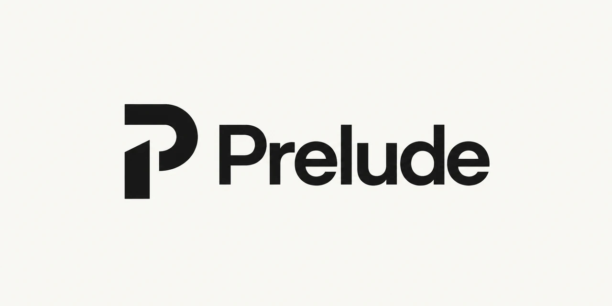

# Prelude

<p align="center">
  
</p>

**A next-generation, agentic-ready Next.js template.**

Prelude gives developers and AI agents a shared foundation: a modern web application, typed APIs, and discoverable tools. Less setup. More building.

- **One contract across interfaces.** Define schemas and operations once with oRPC and ArkType. Reuse them through RPC, REST, automatically generated OpenAPI documentation with Scalar, and native MCP tools.
- **Inspect as you build.** The managed local MCP Inspector lets you discover tools, inspect schemas, execute calls, and preview MCP Apps. Check connectivity from the terminal with `pnpm mcp:check`.
- **Feedback for humans and agents.** Strict TypeScript, Biome, Vitest, Testing Library, Playwright, and React Doctor provide checks and diagnostics, including structured React reports for agents. [AGENTS.md](AGENTS.md) briefs coding agents on the repository.
- **Two languages from the start.** English and Spanish cover the website and PWA feedback, with browser detection and a saved language choice on stable public URLs.
<!-- demo:start -->
- **Interactive examples included.** Explore the task workspace and live MCP tool runner at `/playground`, or use the task-list MCP App, translated into both languages, inside a compatible host. Remove them in one step with `pnpm remove-demo` when you start your own project.
<!-- demo:end -->

The pnpm + Turborepo workspace brings together React 19, Next.js 16 with Turbopack and Cache Components, Base UI shadcn components, Tailwind 4, TanStack Query, nuqs, Zustand, and Serwist. Keep your choice of database, authentication, AI provider, and deployment platform; no provider account or model API key is required to run the examples. Connect your preferred agent explicitly through MCP.

<!-- demo:start -->
The included task list connects the stack end to end. **It is public, shared, in-memory demo data:** every visitor reaches the same process-local list, which resets on restart and differs across server instances. Remove it with `pnpm remove-demo` before using the starter for private or persistent data; see [Remove the demo](docs/remove-demo.md).
<!-- demo:end -->

## Start locally

You need Node.js **26.10.0 or later within 26.x** (`.node-version` records the baseline) and pnpm **12.6.0**, matching `packageManager`. Node 26 no longer includes Corepack, so install pnpm on its own, for example with `npm install --global pnpm@12.6.0` (see [pnpm installation](https://pnpm.io/installation)).

`create-next-app` makes the first Git commit with your Git identity. If `user.name` or `user.email` is not set, that commit fails and `create-next-app` quietly deletes the new `.git` folder: Husky then installs no hooks, and `pnpm customize` and `pnpm remove-demo`, which need Git, fail. Set them first with `git config --global user.name "Your Name"` and `git config --global user.email "you@example.com"`.

Create a new project from the public template:

```sh
pnpm dlx create-next-app@16.4.0 my-app --example https://github.com/ivanpajon/Prelude --use-pnpm --skip-install --yes
cd my-app
pnpm install --frozen-lockfile
pnpm dev
```

Use `--skip-install` for this monorepo: Next.js lives in `apps/web`, and installing after Git initialization lets Husky set up the hooks. The new project starts with its own Git history and no remote; if it has no `.git` folder, run `git init`, `git add -A`, and `git commit -m "chore: initial commit"` before `pnpm install`. For an existing checkout, run only the last two commands. Stop development before changing dependencies or the Node version, then restart it.

Open [localhost:3000](http://localhost:3000). From there:

- **API docs** opens [the Scalar reference](http://localhost:3000/api/docs) for the [OpenAPI document](http://localhost:3000/api/openapi.json), generated from the contracts on each request. See [OpenAPI](docs/openapi.md).
- The MCP endpoint is `/api/mcp`, and `pnpm dev` starts an authenticated MCP Inspector at [localhost:3000/api/mcp/inspector](http://localhost:3000/api/mcp/inspector). `MCP_ENABLED=false` turns MCP off. See [MCP](docs/mcp.md).
- **English / Español** in the header changes language. See [localization](docs/i18n.md) for the URL policies, catalogs, and offline behavior.
<!-- demo:start -->
- **Open playground** opens [the task workspace and MCP explorer](http://localhost:3000/playground): create, edit, complete, and delete tasks, then run the generated MCP tools against the same list. Inspector's **Apps** tab previews the task widget; see [MCP Apps](docs/mcp-apps.md).
<!-- demo:end -->

To try the production build and PWA, run `pnpm build` and then `pnpm start --port 3001`. Keep development and production on separate ports: an installed production service worker keeps controlling its origin.

With Docker running, `pnpm stack:prod` serves production at [localhost:3001](http://localhost:3001), and `pnpm stack:dev` runs development with Compose Watch at [localhost:3000](http://localhost:3000). See [Docker](docs/docker.md).

## Commands

| Command | Purpose |
| --- | --- |
| `pnpm dev` | Start Next.js with Turbopack and the managed local MCP Inspector. |
| `pnpm dev:app` | Same as `pnpm dev` without the MCP Inspector: only the Next.js port must be free. |
| `pnpm mcp:check` | Check the running MCP endpoint with the pinned Inspector CLI; supports `--url`. |
| `pnpm build` | Build Next.js, then generate the Serwist worker. |
| `pnpm start` | Serve an existing production build. |
| `pnpm stack:prod` | Build and start the production Docker Compose stack, and wait until it is healthy. |
| `pnpm stack:dev` | Start the development Docker Compose stack with Watch and MCP Inspector. |
| `pnpm check` | Check Biome and strict TypeScript. |
| `pnpm fix` | Apply formatting and supported lint fixes. |
| `pnpm test` | Run Vitest unit and component tests. |
| `pnpm test:coverage` | Run tests with V8 coverage reports. |
| `pnpm test:ui` | Open Vitest's local test explorer in watch mode. |
| `pnpm test:dev` | Check development rendering and the embedded MCP Inspector. |
| `pnpm test:e2e` | Build, then run production browser and MCP protocol scenarios with Playwright. |
| `pnpm test:cache` | Verify generated build artifacts restore from Turbo cache. |
| `pnpm verify` | Run the complete native verification sequence. |
| `pnpm test:stack` | Verify the Docker stacks and report image, build, and runtime measurements. |
| `pnpm test:stack:quick` | Build the production image once and check the running container. |
| `pnpm customize` | Rename the root package and workspace scope, reinstall, and validate. |
| `pnpm react-doctor` | Run optional React diagnostics with file locations. |
| `pnpm --silent react-doctor:json` | Print a structured diagnostic report for agents. |

<!-- demo:start -->
`pnpm remove-demo` deletes the task demo and keeps the infrastructure; `--dry-run` previews the changes. It removes itself when it succeeds.
<!-- demo:end -->

Run `pnpm exec playwright install chromium` once before the browser checks. Husky runs Biome on staged files and Commitlint on commit messages (Conventional Commits, such as `feat: add profile settings`); hooks only see staged files, so run `pnpm check` and `pnpm test` too. On every pull request, GitHub Actions audits production dependencies and runs the same checks as `pnpm verify`, split into parallel jobs, plus a Docker smoke test, in about 2 minutes. The full `pnpm test:stack` runs as parallel jobs on pushes to `main` or `develop`, weekly, and on pull requests that change Docker or development files. See [verification](docs/verification.md) for what each check covers.

## Make it yours

1. **Site identity.** Set the display name, slug, repository URL, and header logo in `apps/web/src/site.ts`. They feed the metadata, manifest, API reference, offline page, MCP server name, the label of the header's home link, and the footer link (leave the URL unset to hide it). Tests read these values from `site.ts`. One translated text still contains the name: `Home.metaTitle` in `packages/i18n/src/messages/en/site.json` and `es/site.json`. Also replace the footer credit, `Common.footer` in `site.json` ("Made with ❤️ by Ivan Pajon"). Change other metadata in `apps/web/src/app/[routingMode]/[locale]/layout.tsx` and the manifest colors in `apps/web/src/app/manifest.ts`.

   <!-- demo:start -->
   The demo's texts contain the name too: `Playground` in `site.json` and the MCP App texts in `widget.json`. `pnpm remove-demo` deletes them.
   <!-- demo:end -->

2. **Package names.** Keep the private `@repo` scope, or rename it and the root package; preview with `--dry-run` first. See [customization](docs/customization.md).

   ```sh
   pnpm customize --name my-app --scope "@acme"
   ```

<!-- demo:start -->
3. **Remove the demo** from a clean Git checkout, then review and commit the diff. It leaves an empty contract, an OpenAPI document with no paths, and an MCP endpoint with no tools; then [add your first procedure](docs/openapi.md#add-or-change-a-procedure). See [Remove the demo](docs/remove-demo.md) for the full list, or to keep part of it.

   ```sh
   pnpm remove-demo --dry-run
   pnpm remove-demo
   ```

<!-- demo:end -->
4. **Home page.** Replace `apps/web/src/app/[routingMode]/[locale]/page.tsx` and its `Home` messages freely; the infrastructure tests don't depend on its text. Keep `Home.metaTitle` and `Home.metaDescription`, which the layout uses for the site metadata, or change the layout too. Keep `<SiteHeader />`: the localization tests use its language selector and **Language in URL** switch, and the Docker development test edits it to check live reload. Keep one level-1 heading, which the tests look for. The animation previews are optional; [animation](docs/motion.md) explains how to remove them with their tests.
5. **Branding assets.** Replace the icons in `apps/web/public/icons`, the web logo `apps/web/public/branding/logo.png` (its path and size are `logo` in `apps/web/src/site.ts`), and the README banner in `docs/assets`, and adjust the theme in `packages/ui/src/styles/globals.css`.
6. **License.** Prelude uses the [MIT License](LICENSE). Set your own copyright holder there, or choose another license and update `license` in `package.json`.
7. **Docs.** Rewrite this README for your project. Delete `docs/verification-history.md` and `docs/docker-measurements.md`, the template's own records, and the sentences that link to them; see [template history](docs/customization.md#template-history). In `docs/requirements.md`, delete the sentence that starts "Delivery is organized into local commits" under **Development workflow**: it describes how the template was built. Review `docs/skills.md`, a dated shortlist of agent skills: install the ones you want, then update or delete it.
8. **CI branches.** Both workflows run on pushes only to `main` and `develop`. If your default branch has another name, add it to `on.push.branches` in `.github/workflows/ci.yml` and `.github/workflows/docker.yml`. Private repositories spend Actions minutes; see [continuous integration](docs/verification.md#continuous-integration).
9. **Dependency updates.** Install the free Renovate GitHub App to receive the grouped update pull requests configured in `renovate.json`; see [dependency updates](docs/requirements.md#dependency-updates).

Then build on the starter:

- Add components with the pinned CLI, such as `pnpm --filter @repo/ui exec shadcn add dialog`, and import them from `@repo/ui/components/*`.
- Set the API version, tags, and descriptions in `apps/web/src/lib/openapi.ts`; MCP tools follow the same operations.
- Add origins to the Content Security Policy in `apps/web/next.config.ts` before loading scripts, images, or APIs from another host; see [security headers](docs/architecture.md#security-headers).
- Import dates and times from `@repo/temporal` ([Temporal](docs/temporal.md)), and use the shared Motion provider for animations that honor reduced motion ([animation](docs/motion.md)).
- Read [architecture](docs/architecture.md) for data access, state, and caching, and [requirements](docs/requirements.md) for the stack and deferred choices. [React diagnostics](docs/diagnostics.md) and [candidate skills](docs/skills.md) cover agent tooling.

## Deploy

<!-- demo:start -->
Remove the demo first: its task list is public and lives in memory.

<!-- demo:end -->
Any host with Node.js 26 can run the app. From the repository root:

```sh
pnpm install --frozen-lockfile
pnpm build
pnpm start --port 8080
```

`pnpm start` uses port 3000 unless you pass `--port` or set `PORT`. The server checks its variables, listed in `apps/web/.env.example`, at startup and stops if one is invalid. To run in a container, use the production Docker image; see [deploying on a server](docs/docker.md#deploying-on-a-server). On platforms that build Next.js from a monorepo, set the app directory to `apps/web` and the Node version from `.node-version`.

Serve the site over HTTPS: browsers install the service worker only on HTTPS origins and localhost. If your pages load anything from another host, add it to the Content Security Policy first, as described above.

## License

Prelude is released under the [MIT License](LICENSE).
